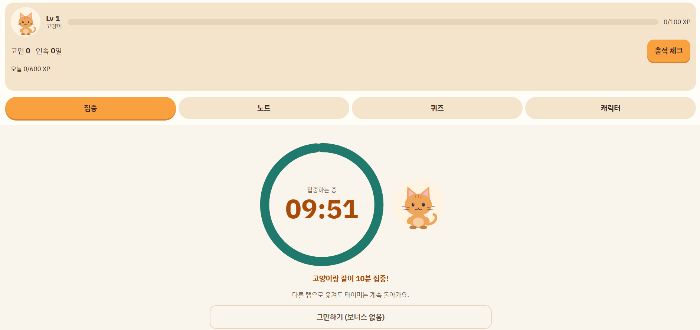
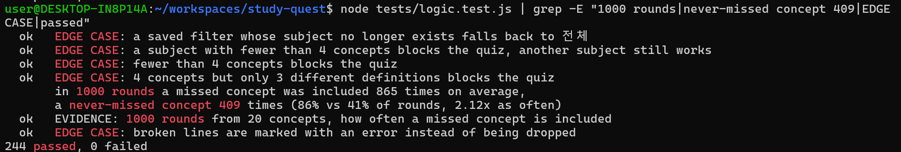
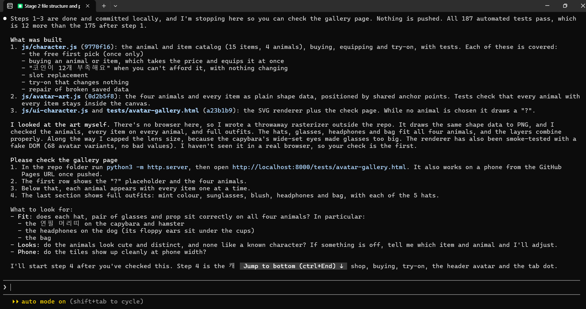
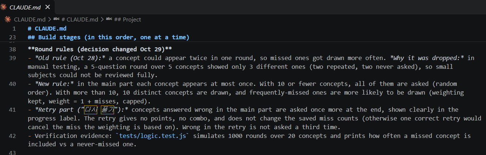
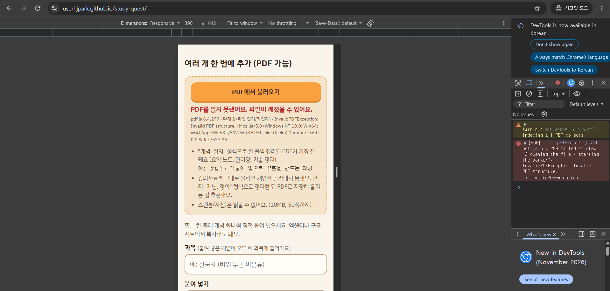

# Study with Pet (펫이랑 같이 공부해요)

- Live site: https://userhjpark.github.io/study-quest/
- Repo: https://github.com/userhjpark/study-quest

The app was first called "Study Quest", so the repo name is still `study-quest`.

## Purpose and intended user

This is a study game for students who find it hard to stay motivated. You type "concept: definition" pairs for any subject. The site turns them into quizzes. Studying gives XP, coins, and levels. You spend coins on a pet and its hats, colors, and glasses.

The app uses no AI and no paid service, so it is free to use. I built it with Claude Code. All code is plain HTML, CSS, and JavaScript, written from scratch.

I get bored when I memorize by rereading my notes, and I study better when there is a reward. I wanted a free tool that works with whatever subject I am studying, not one fixed course.



## How to use it

Open the live site (phone or desktop, light or dark). The tabs are:

- **집중 (Focus):** a timer (1, 10, 15, 25 minutes, or your own length). It stores the end time, so it stays correct in a background tab. When it ends, a "퀴즈 시작" button appears.
- **노트 (Notes):** add concepts by subject, paste many lines, or load a text-based PDF. A preview shows ok, duplicate, and invalid lines before saving.
- **퀴즈 (Quiz):** each concept is asked once, up to 10 per round. Missed concepts are drawn more often. Wrong answers get one retry. You need at least 4 concepts in the subject.
- **캐릭터 (Character):** pick and name your pet, try items on, and buy them with coins.

To run it locally (double-clicking `index.html` does not work with ES modules):

```
python3 -m http.server
```

Then open http://localhost:8000. Tests: `node tests/logic.test.js`.

## Work process

I worked in stages, one at a time: notes and quiz, then rewards and timer, then the character shop, then PDF import. Before each stage the agent showed me a plan, and I approved it first. After each stage I tested it myself, and then we made a commit. I deployed right after Stage 1.

## Claude Code evidence and verification

- **Automated:** 244 Node tests cover the pure logic (quiz options, weighting, combo, XP cap, streaks, levels, import parsing).
- **Evidence test:** it simulates 1000 rounds over 20 concepts. A missed concept was in 86% of rounds, and a never-missed one in 41%. That is 2.12 times as often.
- **Manual:** I walked through `tests/manual-checklist.md` on the live site, on desktop and iPhone, in light and dark mode.
- **Edge case:** with fewer than 4 concepts in a subject, the quiz is blocked with a message.



## Three effective practices

1. **Split the checking.** The agent ran the automated tests and always told me what it could not check, because it has no browser. I tested those parts myself, in the browser and on my iPhone. This is how I found the 3-of-5 quiz problem and the PDF and iPhone failures. At first I expected the agent to finish everything, but almost every real problem appeared only when I clicked through it myself, so testing became my main job.
2. **Report bugs precisely.** I wrote "when I do X, Y happens, I expected Z", with numbers. When I was unsure, I tested in two orders. The streak A/B test showed the cause was a missing reload, not a bug.
3. **CLAUDE.md as project memory.** Rules, decisions, and reasons were written there, so new or compacted sessions continued correctly. I also corrected the agent when it got the date wrong, twice.





## Three difficulties

1. **The round rules changed after manual testing.** At first a concept could appear twice in a round. In my test, a 5-question round over 5 concepts showed only 3 different ones. Two repeated and two never came. Small subjects could not be reviewed fully. New rule: each concept appears at most once, and wrong ones get a retry at the end. The weighting was kept.
2. **PDF import passed in Node but failed in the browser.** The error message was generic, and it hid the real cause. We added a log line for every step and found it: pdf.js 6 has no `doc.destroy()`. The same PDF also failed on my iPhone Safari. An older pdf.js (3.11.174) as a fallback fixed it.
3. **Scope.** My ideas kept growing: a dashboard, a to-do list, a 7-day chart, concept editing, a leaderboard. I cut them because of the deadline and to keep the scope manageable. I kept only the dashboard ("오늘의 공부"). The leaderboard was the hardest cut. At first I thought competing with friends would motivate me most. But while building, I realized the heart of this app is growing my own pet and studying together with it. A leaderboard would also need a server and accounts. So I focused on the pet instead, and used the time for PDF import, which better answered my professor's question about what content the app can handle.



## Known limitations

- XP, coins, and streaks live in localStorage. They can be changed by editing browser data or the device clock.
- Data stays in one browser; clearing site data erases it.
- Subjects cannot be renamed or deleted. Concepts cannot be edited: delete and add again.
- Two open tabs can overwrite each other's progress. Use one tab.
- XP and coins are paid when a round ends. Quitting midway gives nothing. Only XP has a daily cap.
- **PDF import works best for summary notes in "concept: definition" form.** A 10-page lecture PDF gave 17 concepts, but only about 12 were usable: headings with a ":" count as concepts, and some line breaks lose a space. Choosing concepts from free text would need AI, so the preview matters. Scanned PDFs are not supported (no OCR), and two-column pages can come out in odd order.
- pdf.js and the font load from CDNs, so PDF import needs internet.


## Future work

A daily to-do list, a global leaderboard, a 7-day focus chart, better PDF cleanup, and more animals.

## Third-party

- pdf.js 6.4.299 and 3.11.174 (jsDelivr CDN), loaded only when a PDF is chosen
- IBM Plex Sans KR (Google Fonts, SIL Open Font License)
- Neither is committed to the repo.

## Key source files

1. `js/quiz.js`: builds rounds, picks distinct options, weights missed concepts, retry part
2. `js/rewards.js`: XP, levels, coins, daily cap, streak, check-in
3. `js/character.js`: pets, items, prices, try-on, buying
4. `js/pdf-text.js`: rebuilds lines from PDF text pieces and joins wrapped lines, with limits and scan detection
5. `js/ui.js`: all screen updates (no game rules)
